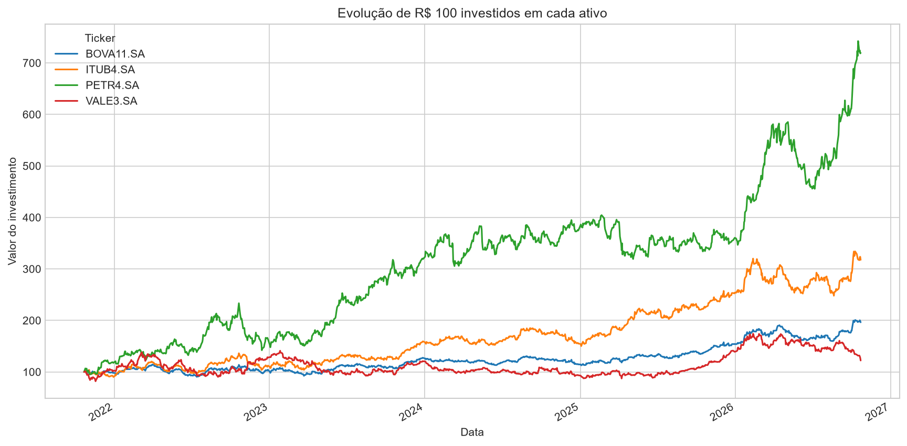
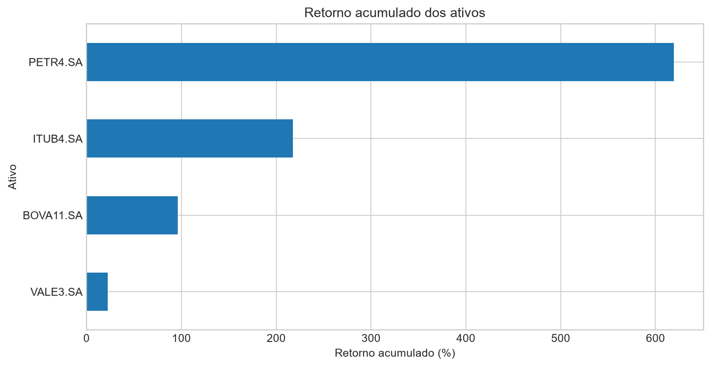
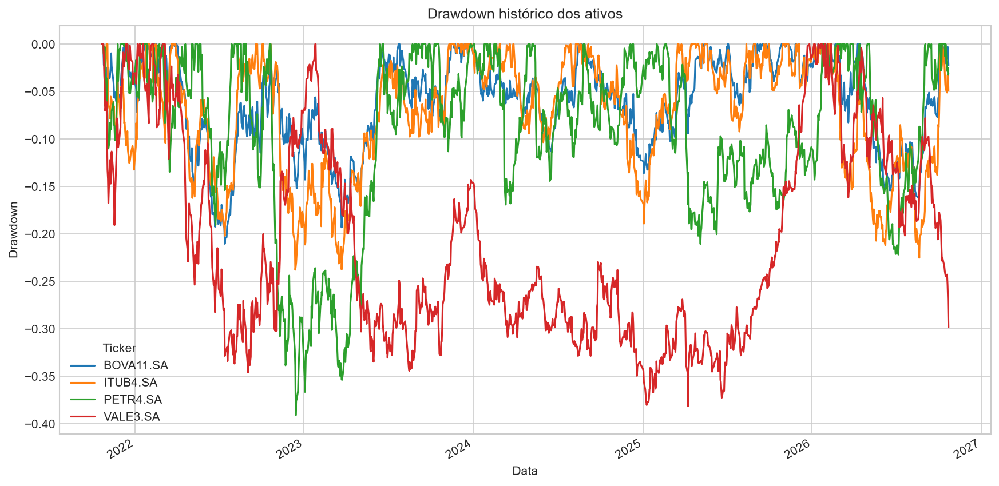
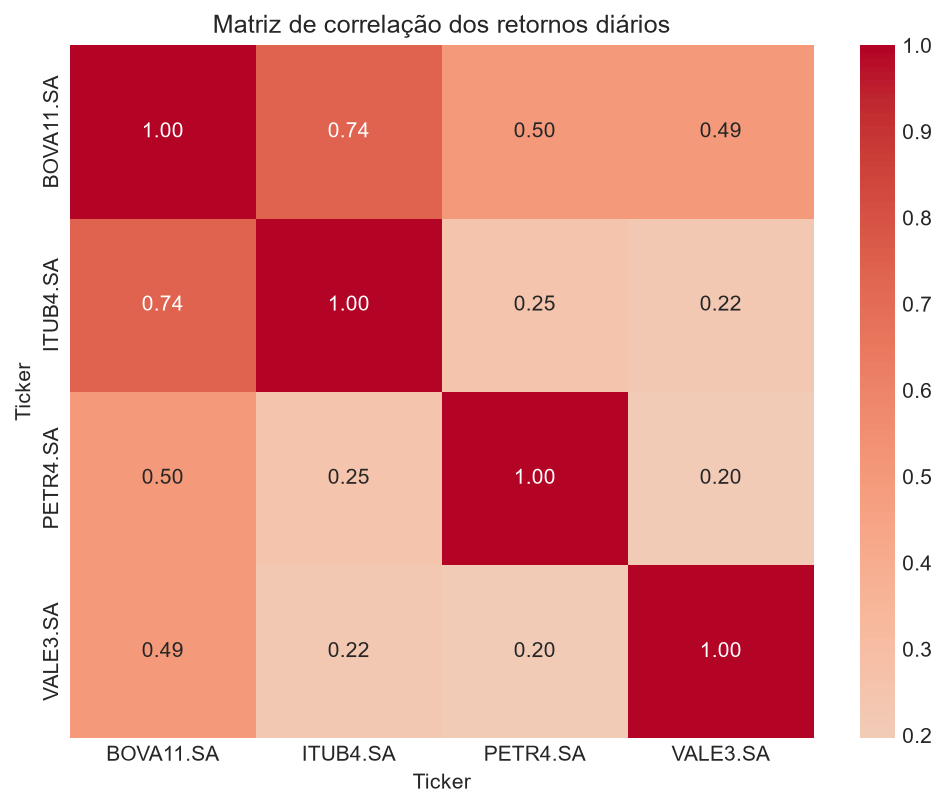

# Análise quantitativa de ativos brasileiros

Projeto de análise quantitativa do comportamento histórico de **PETR4, VALE3, ITUB4 e BOVA11**
(usado como aproximação do mercado acionário brasileiro) em termos de retorno, risco e exposição ao mercado.

## Métricas analisadas

- Retorno acumulado e anualizado (CAGR)
- Volatilidade anualizada
- Sharpe Ratio (taxa livre de risco igual a zero)
- Drawdown e Maximum Drawdown
- Correlação com o BOVA11
- Beta em relação ao BOVA11

## Dados

Preços diários ajustados dos últimos 5 anos (22/10/2021 a 22/10/2026, 1.247 pregões), obtidos do
Yahoo Finance com a biblioteca `yfinance` (`auto_adjust=True`, ou seja, já considerando dividendos
e desdobramentos). Por isso os preços não coincidem com a cotação histórica "crua".

## Resultados

| Ativo | Retorno acumulado | Retorno anualizado | Volatilidade anualizada | Sharpe | Max. drawdown |
|---|---:|---:|---:|---:|---:|
| PETR4 | 619,46% | 48,40% | 31,47% | 1,427 | -39,10% |
| ITUB4 | 217,66% | 26,01% | 23,70% | 1,104 | -23,76% |
| BOVA11 | 96,38% | 14,45% | 18,29% | 0,838 | -21,03% |
| VALE3 | 22,21% | 4,09% | 29,11% | 0,284 | -38,15% |

Correlação dos retornos diários com o BOVA11: ITUB4 0,74, PETR4 0,50 e VALE3 0,49.
A tabela completa, com o beta, é gerada em `data/resumo_metricas.csv`.

**Principais conclusões**

- PETR4 teve o maior retorno e o maior Sharpe, mas também a maior volatilidade e o pior drawdown.
- BOVA11 teve a menor volatilidade e a menor queda máxima, efeito da diversificação.
- ITUB4 foi a ação mais ligada ao mercado (maior correlação com o BOVA11).
- VALE3 teve o pior retorno e, ainda assim, um drawdown quase tão profundo quanto o da PETR4.

### Gráficos






## Estrutura do projeto

```
├── data/        # preços ajustados e tabela de métricas (gerados pelo notebook)
├── figures/     # gráficos salvos pelo notebook
├── notebooks/   # 01_analise_quantitativa.ipynb
├── reports/     # relatório final
├── requirements.txt
└── README.md
```

## Como rodar

```bash
python -m venv .venv
source .venv/bin/activate        # Windows: .venv\Scripts\activate
pip install -r requirements.txt
jupyter notebook notebooks/01_analise_quantitativa.ipynb
```

Ao executar o notebook, os dados são salvos em `data/` e os gráficos em `figures/`.

## Limitações

- Os resultados são históricos e dependem do período analisado. Não são previsão de desempenho futuro
  nem recomendação de investimento.
- O Sharpe usa taxa livre de risco zero, o que o infla no contexto brasileiro. Um próximo passo é descontar o CDI.
- Os dados vêm de uma única fonte (Yahoo Finance); os ajustes por proventos podem divergir de outras fontes.
- Correlação e beta são medidas lineares e instáveis no tempo; não indicam causalidade.
